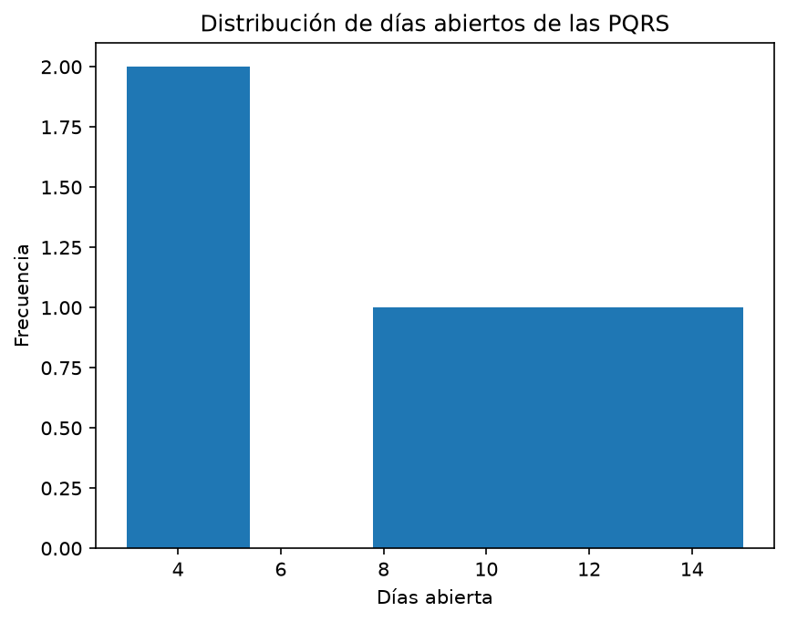
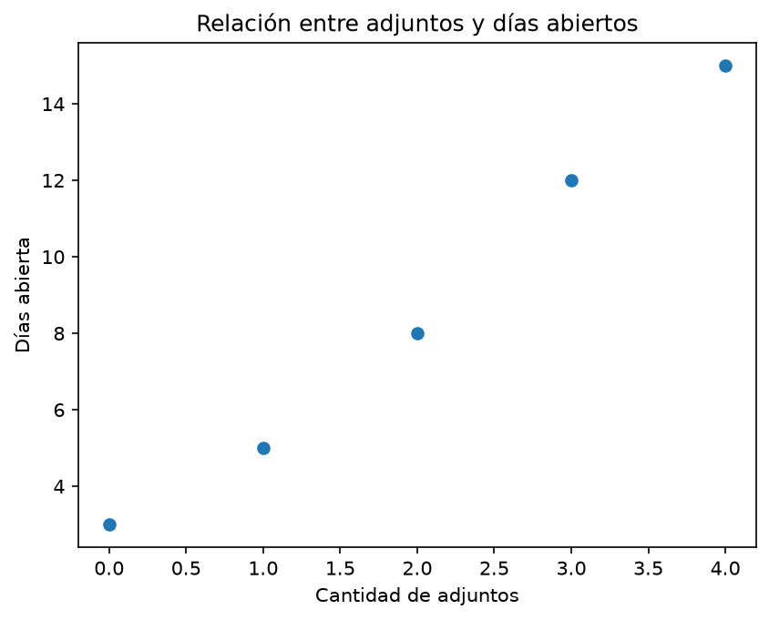

# Curso de Inteligencia Artificial

Repositorio académico para desarrollar las actividades del curso de Inteligencia Artificial y el proyecto **Resuelve**, una propuesta orientada al análisis de Peticiones, Quejas, Reclamos y Sugerencias (PQRS).

## Ejecución del proyecto final desde cero

Esta es la **ruta recomendada para la evaluación del profesor**. Todos los comandos se ejecutan en una terminal, **desde la raíz de `CursoIA`**. El proyecto es una demostración de IA mediante scripts de Python: **no tiene servidor ni interfaz web que abrir**.

### 1. Requisitos previos

- Tener instalados **Git** y **Docker** (Docker Desktop abierto en Windows/macOS, o Docker Engine en Linux).
- Contar con conexión a Internet para descargar el código y construir la imagen por primera vez.
- **No** es necesario instalar Python ni las bibliotecas en el equipo anfitrión.

Comprobar que Docker responde:

```bash
docker --version
docker compose version
docker info
```

Si `docker info` indica que el daemon no está disponible, iniciar Docker antes de continuar.

### 2. Descargar el proyecto

```bash
git clone https://github.com/Gustavo-87/CursoIA.git
cd CursoIA
```

**No entrar en `proyectos/resuelve-pqrs/` para los pasos siguientes**: existen dos archivos `docker-compose.yml` en este repositorio. Esta guía utiliza exclusivamente el de la **raíz**, cuyo servicio se llama `python` (no `python_ia`).

### 3. Construir la imagen Docker

```bash
docker compose build
```

El Dockerfile de la raíz utiliza Python 3.13 e instala las dependencias de `requirements.txt`. El primer proceso puede descargar paquetes de Internet.

Comprobar el nombre del servicio:

```bash
docker compose config --services
```

La salida debe incluir `python`. Los comandos `docker compose run --rm` crean un contenedor temporal para cada ejecución y lo eliminan al terminar; **no hace falta** ejecutar `docker compose up`.

### 4. Preparación de datos y perceptrón del segundo corte

Ejecutar en este orden:

**4.1.** Validar y preparar los 12 casos sintéticos originales:

```bash
docker compose run --rm -e MPLBACKEND=Agg python python proyectos/resuelve-pqrs/src/preparacion_pqrs.py --segundo-corte
```

**4.2.** Regenerar los tres gráficos exploratorios y sus interpretaciones:

```bash
docker compose run --rm -e MPLBACKEND=Agg python python proyectos/resuelve-pqrs/src/preparacion_pqrs.py --visualizaciones-segundo-corte
```

**4.3.** Entrenar la neurona sigmoide implementada con NumPy:

```bash
docker compose run --rm -e MPLBACKEND=Agg python python proyectos/resuelve-pqrs/src/perceptron_proyecto.py
```

Resultados de referencia: **12 registros**, exactitud de **9/12 (75 %)** en entrenamiento y pérdida final cercana a **0.5271**. Son métricas del segundo corte, **no** del modelo final.

### 5. Generar datos y entrenar los modelos finales

**5.1.** Crear de manera reproducible el dataset final de 150 PQRS sintéticas (semilla 42):

```bash
docker compose run --rm -e MPLBACKEND=Agg python python proyectos/resuelve-pqrs/src/generar_datos.py
```

Salida de referencia: **150 filas**; `prioridad_alta`: **120 de clase 0** y **30 de clase 1**.

**5.2.** Entrenar el perceptrón final con NumPy y generar su curva de aprendizaje:

```bash
docker compose run --rm -e MPLBACKEND=Agg python python proyectos/resuelve-pqrs/src/perceptron_final.py
```

**5.3.** Entrenar y comparar **regresión logística, KNN y árbol de decisión** con Scikit-Learn:

```bash
docker compose run --rm -e MPLBACKEND=Agg python python proyectos/resuelve-pqrs/src/modelo_proyecto.py
```

El script realiza partición estratificada (120 entrenamiento / 30 prueba), validación cruzada de cinco pliegues sobre entrenamiento, cálculo de métricas y selección por **F1 promedio de validación cruzada**. Guarda el clasificador elegido en `proyectos/resuelve-pqrs/modelo_pqrs_final.joblib` y genera los gráficos de evaluación.

Resultado documentado con estos datos: **regresión logística**, F1 de validación cruzada cercano a **0.433**, exactitud de prueba **0.767** y recall de clase alta **0.333**. Las dependencias actuales no están fijadas a versiones exactas; pueden existir diferencias entre entornos.

### 6. Ejecutar predicciones con el modelo guardado

**Después** del paso 5.3:

```bash
docker compose run --rm -e MPLBACKEND=Agg python python proyectos/resuelve-pqrs/src/usar_modelo.py
```

El programa **carga el archivo `.joblib` sin reentrenar** y muestra predicciones para tres casos académicos. En la ejecución documentada los resultados fueron **No alta, No alta y Alta**, respectivamente.

### 7. Ejecutar las pruebas automatizadas

```bash
docker compose run --rm -e MPLBACKEND=Agg python python -m unittest discover -s proyectos/resuelve-pqrs/tests -v
```

Se incluyen **19 pruebas** del segundo corte (preparación, gráficos y perceptrón). Una ejecución correcta termina con **`OK`**. Estas pruebas **no sustituyen** la verificación de los cuatro scripts finales de los pasos 5 y 6.

### 8. Consultar resultados, informe y código

| Elemento | Ubicación en el repositorio |
|---|---|
| Dataset final | `proyectos/resuelve-pqrs/data/pqrs_final_150.csv` |
| Modelo guardado | `proyectos/resuelve-pqrs/modelo_pqrs_final.joblib` (generado al entrenar) |
| Curva de aprendizaje final | `proyectos/resuelve-pqrs/graficos_final/curva_perceptron.png` |
| Matriz de confusión | `proyectos/resuelve-pqrs/graficos_final/matriz_confusion.png` |
| Real frente a predicho | `proyectos/resuelve-pqrs/graficos_final/real_vs_predicho.png` |
| Resultados del segundo corte | `proyectos/resuelve-pqrs/informes/segundo_corte/` |
| Código fuente y documentación técnica | [`proyectos/resuelve-pqrs/`](proyectos/resuelve-pqrs/README.md) |
| **Informe final en PDF** | [**Consultar informe final**](proyectos/resuelve-pqrs/docs/Informe_Final_Integraci%C3%B3n%20de%20IA%20para%20la%20Gesti%C3%B3n%20de%20PQRS.pdf) |

Las rutas corresponden a la carpeta del repositorio; los archivos generados se guardan en el directorio local gracias al volumen de Docker Compose (`.:/app`).

### 9. Finalizar o repetir

Con `docker compose run --rm` los contenedores se eliminan después de cada comando. Para liberar recursos opcionalmente:

```bash
docker compose down
```

Para repetir la demostración, volver al **paso 4** y continuar en el orden indicado. Si solamente se quiere regenerar el modelo final, repetir los **pasos 5 a 7**.

### Limitaciones de la demostración

Los datos son **sintéticos** y la etiqueta `prioridad_alta` del conjunto final se genera con una regla basada en las propias variables de entrada. Existe **circularidad metodológica**: las métricas describen el aprendizaje de esa regla artificial, **no** capacidad predictiva validada en PQRS reales. El sistema **no está integrado en producción con Resuelve ERP** ni debe utilizarse para asignar prioridades reales.

---

## Objetivo del proyecto

Aplicar Python, análisis de datos e Inteligencia Artificial para procesar información de PQRS, identificar patrones y generar resultados que apoyen su gestión y priorización.

Los datos utilizados actualmente son simulados y no contienen información real de usuarios.

## Tecnologías

- Python 3
- CSV y Markdown
- Pandas
- Docker y Docker Compose
- Git y GitHub
- Visual Studio Code

## Estructura principal

```text
CursoIA/
├── Clase 1/
│   └── proyecto_resuelve_ia.md
├── Clase 2/
│   ├── analisis_de_datos.py
│   ├── informe_proyecto.md
│   └── investigacion_proyectos.md
├── Clase 3/
│   ├── analizar_cultivos.py
│   ├── cultivos.csv
│   ├── informe_cultivos.md
│   ├── datos.txt
│   ├── cultivos.json
│   └── ejercicios de lectura, escritura y excepciones
├── src/
│   ├── analisis_pqrs.py
│   ├── analisis_proyecto.py
│   ├── cargar_datos.py
│   ├── gestion_pqrs.py
│   └── main.py
├── proyectos/
│   └── resuelve-pqrs/          # proyecto de IA aplicado a Resuelve
│       ├── src/                # análisis, preparación ML y neuronas lógicas
│       ├── data/               # datasets propios del proyecto (separados de data/)
│       └── README.md           # problemática y alcance del proyecto
├── Dockerfile
├── docker-compose.yml
└── requirements.txt
```
## Actividades anteriores del curso (histórico)

### Análisis Exploratorio de Datos

Para la Clase 4 se realizó un Análisis Exploratorio de Datos (EDA) sobre el archivo `data/pqrs/pqrs.csv`, utilizando NumPy y Matplotlib.

#### Variables analizadas

Se seleccionaron dos variables numéricas relacionadas con la gestión de PQRS:

- `dias_abierta`: cantidad de días que una PQRS permanece abierta.
- `cantidad_adjuntos`: cantidad de archivos adjuntos asociados a cada PQRS.

#### Estadísticas descriptivas

Para la variable `dias_abierta` se obtuvieron los siguientes resultados:

- Media: 8.60 días.
- Mediana: 8.00 días.
- Desviación estándar: 4.41 días.
- Mínimo: 3 días.
- Máximo: 15 días.

Para la variable `cantidad_adjuntos`:

- Media: 2.00 adjuntos.
- Mediana: 2.00 adjuntos.
- Desviación estándar: 1.41.
- Mínimo: 0 adjuntos.
- Máximo: 4 adjuntos.

#### Visualizaciones

El análisis genera dos gráficos:



- `data/eda/histograma_dias_abierta.png`: muestra la distribución del tiempo que permanecen abiertas las PQRS.


- `data/eda/dias_vs_adjuntos.png`: muestra la relación entre la cantidad de adjuntos y los días que permanece abierta cada PQRS.

#### Patrones y relaciones encontradas

En el conjunto de datos utilizado se observa que las PQRS con mayor cantidad de archivos adjuntos también presentan una mayor cantidad de días abiertas.

El coeficiente de correlación entre `cantidad_adjuntos` y `dias_abierta` es aproximadamente `0.9943`, lo que representa una relación positiva muy fuerte dentro de este conjunto de datos.

Sin embargo, los datos utilizados son sintéticos y el conjunto contiene únicamente cinco registros. Por esta razón, esta correlación no permite concluir que la cantidad de adjuntos sea la causa de un mayor tiempo de atención. El resultado debe considerarse como un patrón inicial que podría verificarse posteriormente utilizando un conjunto de datos más amplio.

#### Relación con el futuro modelo de Inteligencia Artificial

El análisis exploratorio permite identificar variables que podrían ser útiles para un futuro modelo de Inteligencia Artificial orientado a la gestión y priorización de PQRS.

Variables como el tiempo de apertura, la cantidad de adjuntos, el tipo de solicitud y el estado podrían utilizarse posteriormente para identificar patrones, clasificar solicitudes o estimar cuáles PQRS pueden requerir mayor atención.

Antes de construir un modelo predictivo será necesario disponer de una mayor cantidad de registros y evaluar otras variables relevantes del proceso de gestión de PQRS.

### Avance 2

El segundo corte se desarrolla en [`proyectos/resuelve-pqrs/`](proyectos/resuelve-pqrs/README.md#avance-2),
separado de los ejercicios de clase y sin modificar Resuelve ERP.

- **Preparación:** se conservan los 12 registros sintéticos originales y se
  documentan etiquetas académicas `prioridad_alta` (0 = media/baja; 1 = alta).
  Pandas verifica estructura, tipos, nulos, duplicados e inconsistencias.
  No fueron necesarias correcciones: antes 12×6 y después 12×8, sin nulos.
  Las clases contienen 8 casos de clase 0 y 4 de clase 1.
- **Visualizaciones:** tres gráficos Seaborn con interpretaciones: histograma
  de días, conteo por tipo y dispersión días–longitud según prioridad.
  Se conservan los gráficos y datasets de etapas anteriores.
- **Perceptrón sigmoide:** dos entradas estandarizadas (`dias_desde_radicacion`
  y `longitud_descripcion`), pérdida logarítmica y descenso del gradiente con
  NumPy, sin Scikit-Learn. Se usan 10000 épocas, tasa 0.1 e inicio en cero.
- **Resultados:** `w1=1.5041201103`, `w2=1.9560568515`, `b=-1.1298185501`;
  pérdida de `0.6931471806` a `0.5270863308`; exactitud de entrenamiento
  **75 % (9/12)**. El conjunto no es linealmente separable y no se ha medido
  generalización sobre datos independientes.
- **Verificación:** 19 pruebas aprobadas en Docker (Python 3.13.16),
  reproducibilidad numérica y de gráficos comprobada en dos ejecuciones.

#### Ejecución en Docker (segundo corte)

Desde la raíz de **CursoIA**, con Docker iniciado y el servicio único `python`:

```bash
docker compose build
docker compose run --rm -e MPLBACKEND=Agg python python proyectos/resuelve-pqrs/src/preparacion_pqrs.py --segundo-corte
docker compose run --rm -e MPLBACKEND=Agg python python proyectos/resuelve-pqrs/src/preparacion_pqrs.py --visualizaciones-segundo-corte
docker compose run --rm -e MPLBACKEND=Agg python python proyectos/resuelve-pqrs/src/perceptron_proyecto.py
docker compose run --rm -e MPLBACKEND=Agg python python -m unittest discover -s proyectos/resuelve-pqrs/tests -v
```

Los CSV preparados están en `proyectos/resuelve-pqrs/data/`. Los gráficos e
interpretaciones están en
[`informes/segundo_corte/interpretaciones.md`](proyectos/resuelve-pqrs/informes/segundo_corte/interpretaciones.md)
y el análisis del modelo en
[`perceptron/interpretacion.md`](proyectos/resuelve-pqrs/informes/segundo_corte/perceptron/interpretacion.md).
Los comandos regeneran únicamente los archivos de su etapa, no el CSV original.

Los resultados son académicos: muestra pequeña, sintética, desbalanceada y
etiquetas subjetivas. No justifican uso operativo. La publicación en GitHub
queda pendiente de autorización; no se generan PDF ni video en este avance.
