# Integración de IA para la Gestión de PQRS en Conjuntos Residenciales de Cartago, Valle del Cauca

## Problemática

Los administradores de conjuntos residenciales deben atender constantemente peticiones, quejas, reclamos y sugerencias (PQRS) presentadas por los residentes. La redacción de respuestas claras y apropiadas, la selección de formatos para cada caso y el seguimiento de las solicitudes pueden requerir mucho tiempo y generar dificultades en la gestión administrativa.

La plataforma Resuelve permite registrar y hacer seguimiento a las PQRS. Sin embargo, los administradores todavía deben analizar cada solicitud y preparar manualmente gran parte de las respuestas y comunicaciones.

La incorporación de inteligencia artificial en Resuelve permitirá ofrecer ideas de redacción, sugerir plantillas de respuesta y brindar apoyo durante la gestión de las PQRS. De esta manera, los administradores de conjuntos residenciales en Cartago, Valle del Cauca, podrán preparar respuestas con mayor agilidad, mantener una comunicación más clara y organizar mejor la atención de las solicitudes.

## Objetivo

Integrar un asistente de inteligencia artificial en la plataforma Resuelve que, a partir del contenido de cada PQRS, genere ideas de redacción, sugiera plantillas de respuesta y apoye al administrador durante el seguimiento de la solicitud, con el fin de agilizar su gestión y mejorar la claridad de las comunicaciones dirigidas a los residentes.

## Datos

La documentación completa de los datos —diccionario de variables, generación
sintética, privacidad y limitaciones— está en [`data/README.md`](data/README.md).

### Datos sintéticos iniciales (12 casos)

Para el primer avance se utilizó un archivo CSV con 12 datos sintéticos, adaptados de los casos de demostración de Resuelve. La plataforma aún no está desplegada en conjuntos residenciales y, por tanto, no cuenta con registros operativos de residentes.

El conjunto de datos representa solicitudes habituales presentadas por residentes y contiene campos como el número de radicado, el asunto, el tipo de PQRS, el estado, los días transcurridos desde la radicación y la descripción de la solicitud.

El uso de datos sintéticos permite representar escenarios realistas, desarrollar el análisis inicial y proteger la información personal y confidencial de los residentes.

### Dataset final del modelo (`data/pqrs_final_150.csv`)

- **150 registros sintéticos**, generados de forma determinista con **semilla 42**
  por `src/generar_datos.py`.
- Distribución de la variable objetivo `prioridad_alta`:
  **120 no alta (0)** y **30 alta (1)**.
- **No contiene información personal real:** se creó para fines académicos
  porque Resuelve aún no está desplegada en conjuntos residenciales y no
  cuenta con registros operativos de residentes.

#### Variables

| Variable | Tipo | Descripción | Uso en el modelo |
|---|---|---|---|
| `dias_desde_radicacion` | Numérica (entero) | Días transcurridos desde la radicación de la PQRS. | Entrada numérica (estandarizada). |
| `longitud_descripcion` | Numérica (entero) | Número de caracteres de la descripción de la solicitud. | Entrada numérica (estandarizada). |
| `cantidad_adjuntos` | Numérica (entero) | Cantidad de archivos adjuntos asociados a la PQRS. | Entrada numérica (estandarizada). |
| `tipo` | Categórica | Tipo de solicitud: Petición, Queja, Reclamo, Solicitud o Sugerencia. | Entrada categórica (one-hot). |
| `prioridad_alta` | Binaria (0/1) | Etiqueta de prioridad: 1 = alta, 0 = no alta. | Variable objetivo; no es una entrada. |

El detalle por variable (rangos, generación y uso) está en
[`data/README.md`](data/README.md).

#### Contrato de entrada único

El modelo usa exactamente estas cuatro variables, con estos nombres y en este
orden, tanto en `src/modelo_proyecto.py` (entrenamiento) como en
`src/usar_modelo.py` (predicción):

1. `dias_desde_radicacion`
2. `longitud_descripcion`
3. `cantidad_adjuntos`
4. `tipo`

#### Fuente, privacidad y limitaciones

- No contiene información personal real de residentes.
- Es un dataset sintético creado para fines académicos porque Resuelve aún no
  está desplegada y no dispone de registros operativos.
- **Circularidad metodológica:** `prioridad_alta` se generó a partir de las
  mismas variables predictoras del modelo; existe una fuga de información
  estructural entre las entradas y la etiqueta.
- No es válido para uso en operación real.
- Tamaño limitado (150 registros), desbalance de clases (120/30), recall bajo
  de la clase prioridad alta y probabilidades no calibradas.

## Análisis exploratorio de datos

El programa carga los registros del archivo `data/pqrs.csv` como una lista de diccionarios. Posteriormente, utiliza NumPy para analizar la columna `dias_desde_radicacion` y calcular:

- Promedio.
- Valor máximo.
- Valor mínimo.
- Desviación estándar.

También utiliza Matplotlib para generar un gráfico de barras con la cantidad de PQRS registradas por cada tipo.

## Resultados

El análisis de los 12 registros sintéticos produjo los siguientes resultados:

- Promedio de días desde la radicación: 56.50 días.
- Máximo de días desde la radicación: 155 días.
- Mínimo de días desde la radicación: 2 días.
- Desviación estándar: 48.83 días.

## Hallazgos

1. El reclamo es el tipo de PQRS más frecuente, con 4 de los 12 registros analizados.
2. El 50 % de las PQRS se encuentra en estado radicada o en revisión, lo cual representa 6 solicitudes que todavía requieren gestión administrativa.

## Visualización

El siguiente gráfico presenta la cantidad de solicitudes registradas por cada tipo de PQRS:

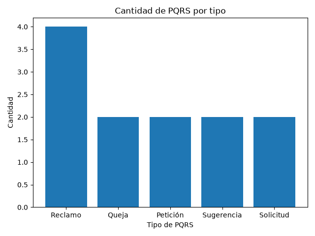

La visualización permite identificar que los reclamos son el tipo de solicitud con mayor frecuencia dentro del conjunto de datos analizado.

## Requisitos

- Python 3.
- NumPy.
- Matplotlib.

Las librerías necesarias se encuentran registradas en `requirements.txt`.

## Ejecución

Desde la carpeta principal del proyecto, instalar las dependencias:

```bash
python -m pip install -r requirements.txt
```

Luego ejecutar el análisis:

```bash
python src/analisis_pqrs.py
```

## Estructura del proyecto

```text
proyectos/resuelve-pqrs/
├── data/
│   ├── README.md                        # diccionario de variables y documentación de datos
│   ├── pqrs.csv                         # 12 casos sintéticos iniciales (Avance 1)
│   ├── etiquetas_prioridad.csv          # etiquetas manuales por radicado (Avance 2)
│   ├── pqrs_preparadas_ml.csv           # dataset preparado en Clase 7
│   ├── pqrs_limpias_segundo_corte.csv   # dataset limpio del Avance 2
│   ├── pqrs_ml_segundo_corte.csv        # entradas y objetivo de los 12 casos
│   ├── resumen_limpieza_segundo_corte.csv
│   └── pqrs_final_150.csv               # dataset final del modelo (150 casos)
├── graficos_final/
│   ├── curva_perceptron.png             # curva de aprendizaje del perceptrón NumPy
│   ├── matriz_confusion.png             # matriz de confusión del mejor modelo
│   └── real_vs_predicho.png             # probabilidad predicha vs clase real
├── informes/
│   └── segundo_corte/
│       ├── interpretaciones.md          # interpretación de los gráficos del Avance 2
│       ├── histograma_dias_pqrs.png
│       ├── pqrs_por_tipo.png
│       ├── antiguedad_vs_descripcion.png
│       └── perceptron/
│           ├── interpretacion.md
│           ├── curva_aprendizaje.png
│           └── frontera_decision.png
├── src/
│   ├── analisis_pqrs.py                 # análisis exploratorio inicial (NumPy/Matplotlib)
│   ├── generar_datos.py                 # genera data/pqrs_final_150.csv (semilla 42)
│   ├── modelo_proyecto.py               # entrena, compara y guarda el mejor modelo (joblib)
│   ├── usar_modelo.py                   # carga el modelo y predice casos nuevos
│   ├── perceptron_proyecto.py           # neurona sigmoide NumPy (Avance 2)
│   ├── perceptron_final.py              # perceptrón NumPy sobre los 150 casos
│   ├── preparacion_pqrs.py              # preparación y limpieza con Pandas
│   ├── neurona_and.py                   # compuerta AND (Clase 8)
│   └── neuronas_logicas.py              # compuertas OR y NOT (Clase 8)
├── tests/
│   ├── test_preparacion_pqrs.py
│   ├── test_visualizaciones_pqrs.py
│   └── test_perceptron_proyecto.py
├── grafico_pqrs.png                     # gráfico histórico (Avance 1)
├── histograma_dias_pqrs.png             # gráficos históricos en la raíz
├── pqrs_por_tipo.png
├── antiguedad_vs_descripcion.png
├── evolucion_error.png                  # compuertas lógicas (Clase 8)
├── evolucion_error_or.png
├── evolucion_error_not.png
├── modelo_pqrs_final.joblib             # mejor modelo guardado con joblib
├── Dockerfile
├── docker-compose.yml
├── requirements.txt
├── .gitignore
└── README.md
```

## Tecnologías utilizadas

- Python 3.
- CSV para almacenar los datos sintéticos.
- NumPy para los cálculos estadísticos.
- Matplotlib para la visualización.
- Git y GitHub para el control de versiones.
- Visual Studio Code como entorno de desarrollo.

## Próximos pasos

En los siguientes avances se plantea integrar inteligencia artificial en Resuelve para:

- Generar ideas de redacción para las respuestas a las PQRS.
- Sugerir plantillas según el tipo de solicitud.
- Apoyar al administrador durante la gestión y seguimiento de cada caso.
- Evaluar las respuestas sugeridas antes de incorporarlas a la plataforma.

## Clase 7 - Preparación de Datos

Para la actividad independiente se utilizó el archivo `data/pqrs.csv`, compuesto por 12 registros sintéticos relacionados con la gestión de PQRS en conjuntos residenciales.

### Exploración con Pandas

El script `src/preparacion_pqrs.py` carga los datos con `pd.read_csv()` y muestra:

- Las primeras cinco filas con `df.head()`.
- La estructura y tipos de datos con `df.info()`.
- Las estadísticas descriptivas con `df.describe()`.
- Los valores nulos por columna con `df.isnull().sum()`.

El conjunto tiene 12 filas y 6 columnas. Se identificó que no existen valores nulos en ninguna de sus columnas.

### Limpieza y preparación

La columna `dias_desde_radicacion` se convierte a formato numérico. El código incluye un manejo condicional: si en futuros registros aparecen valores nulos en esta columna, se reemplazarán mediante la mediana. En los datos analizados no fue necesario aplicar esa imputación.

Las variables categóricas `tipo` y `estado` se codificaron con One-Hot Encoding mediante `pd.get_dummies()`. Esto crea columnas numéricas que pueden usarse en un futuro modelo de aprendizaje automático.

También se creó la columna derivada `longitud_descripcion`, que cuenta los caracteres de la descripción de cada PQRS. Esta variable permite explorar si la extensión del texto presenta alguna relación con la antigüedad de la solicitud.

El resultado se guarda en `data/pqrs_preparadas_ml.csv`. Esta copia contiene datos numéricos preparados para un futuro ejercicio de Machine Learning; todavía no se entrena un modelo, ya que el conjunto tiene únicamente 12 registros sintéticos.

### Visualizaciones con Seaborn

#### Distribución de días desde la radicación

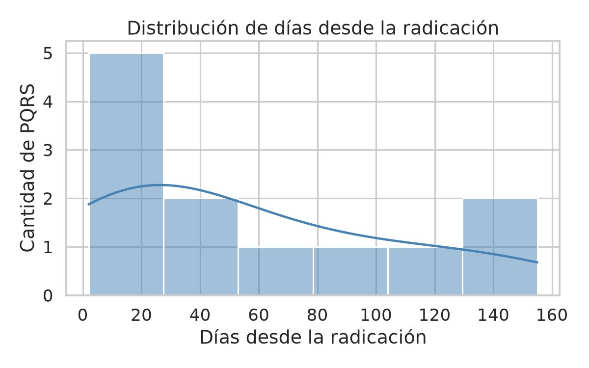

Cinco de las doce PQRS tienen entre 2 y 25 días desde su radicación. Sin embargo, existen solicitudes con 130 y 155 días, lo cual muestra diferencias importantes en la antigüedad de los casos y la necesidad de hacer seguimiento.

#### Cantidad de PQRS por tipo

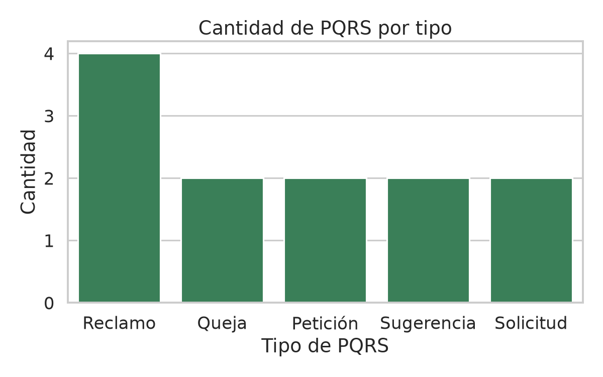

Los reclamos son el tipo más frecuente, con 4 de 12 registros (33,3 %). En este conjunto sintético, este hallazgo puede orientar la creación futura de plantillas e ideas de redacción para reclamos.

#### Antigüedad y longitud de la descripción

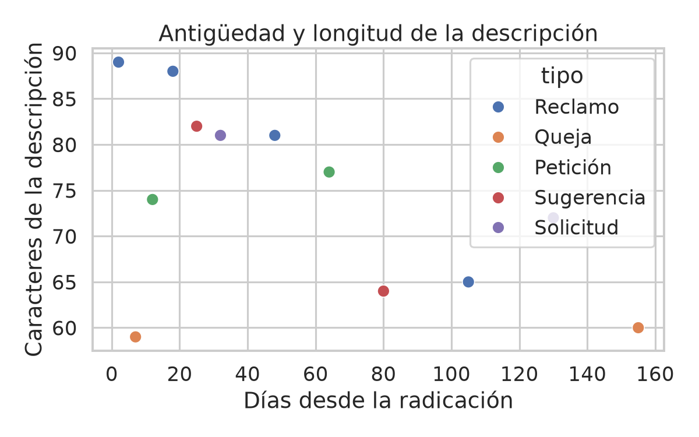

No se observa una relación directa entre los días desde la radicación y la longitud de la descripción. Por ello, una futura solución de IA debería considerar principalmente el contenido y tipo de la PQRS, no solamente su antigüedad.

## Clase 8 - Neurona Artificial y Compuertas Lógicas

En esta actividad se implementó una neurona artificial o perceptrón simple en Python. La neurona calcula una suma ponderada de las entradas y aplica una función escalón para producir una salida de 0 o 1.

Primero se implementó la compuerta AND en `src/neurona_and.py`. Con los parámetros iniciales `w1 = 0.1`, `w2 = 0.1` y `b = 0.0`, la neurona redujo su error hasta cero y aprendió la compuerta en 3 épocas.

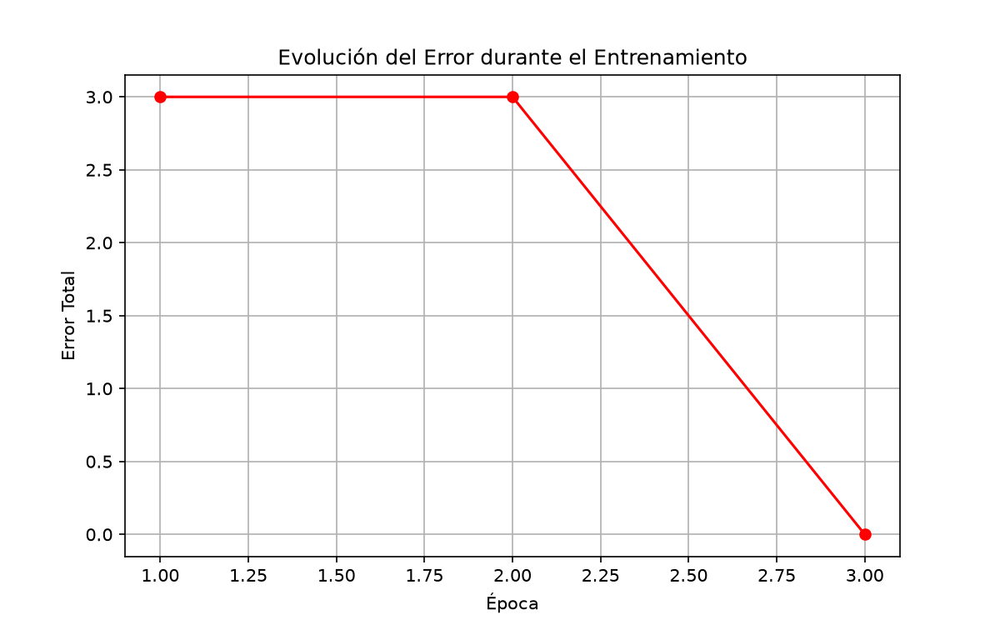

También se implementaron las compuertas OR y NOT en `src/neuronas_logicas.py`.

- La compuerta OR aprendió en 2 épocas.
- La compuerta NOT aprendió en 4 épocas.
- En los tres casos se utilizó una tasa de aprendizaje de 0.1; no fue necesario modificarla porque el error llegó a cero.

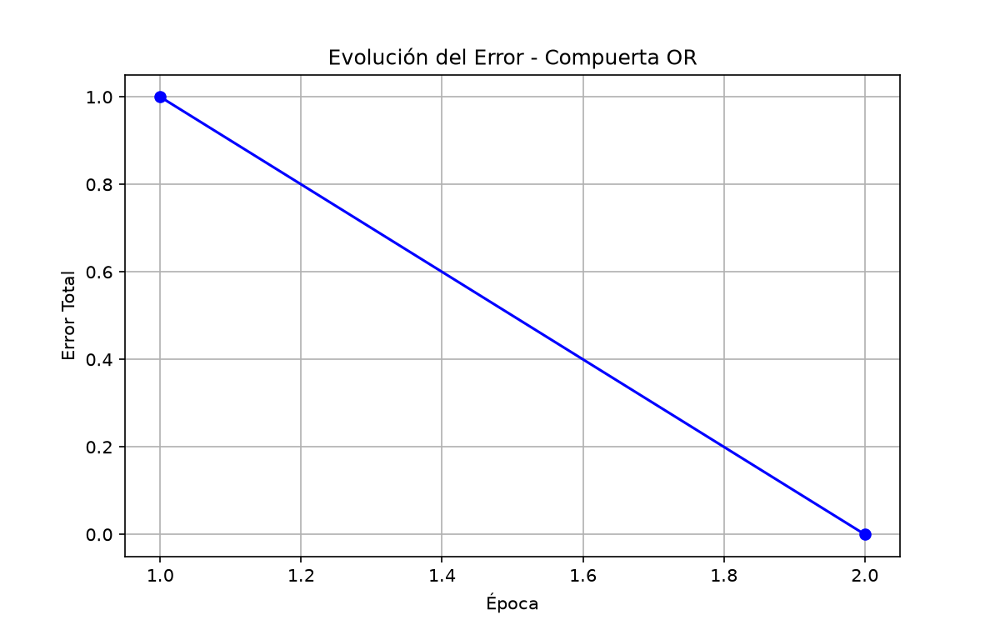

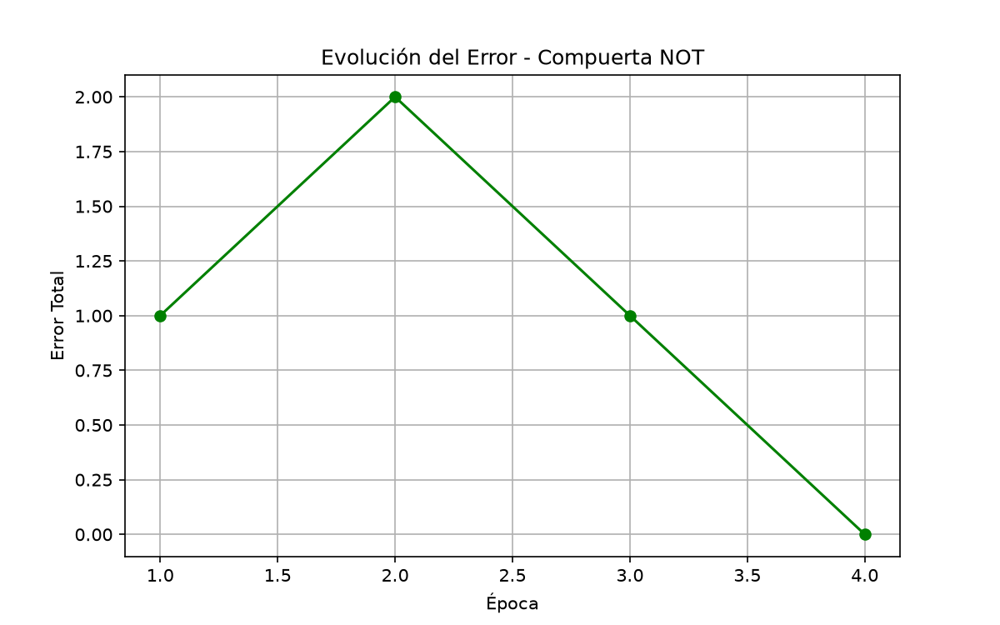

La diferencia principal entre AND y OR está en su salida esperada. AND solo devuelve 1 cuando ambas entradas son 1; OR devuelve 1 cuando al menos una entrada es 1.

La compuerta XOR no puede ser aprendida por una sola neurona o perceptrón simple porque sus resultados no son separables mediante una sola frontera de decisión lineal. Para aprender XOR se requiere una red con más de una neurona, por ejemplo una capa oculta.

## Avance 2

El segundo corte reúne la preparación de datos, tres visualizaciones Seaborn
y una neurona sigmoide implementada con NumPy. Todo el trabajo permanece
separado de Resuelve ERP y conserva los ejercicios y resultados de Clase 7 y 8.

Resumen: 12 registros originales sin ampliar, clases 0/1 con distribución 8/4,
dos entradas estandarizadas y exactitud de entrenamiento del 75 % (9/12).
Los detalles y comandos de preparación y visualización aparecen a continuación;
el modelo y sus resultados se describen en el apartado «Requisito D».

### Preparación para clasificación binaria

Se reutilizan exclusivamente los 12 registros de `data/pqrs.csv`. El modo
`--segundo-corte` de `src/preparacion_pqrs.py` conserva el flujo anterior de
Clase 7 (ejecución sin argumentos), sus gráficos y su CSV preparado.

### Variable objetivo y criterio académico

`prioridad_alta`: **1 = alta**, **0 = media o baja**. Las anotaciones manuales
están en `data/etiquetas_prioridad.csv`, con una justificación por radicado.
Se basan en el asunto y el contenido del incidente: alta cuando se describe
un riesgo físico o de daño material que amerita atención preventiva; media/baja
para trámites, mejoras o afectaciones sin ese riesgo explícito. No se calculan
mediante umbrales de días, longitud ni estado. Representan la gravedad del
incidente **al reportarse**, no una cola de atención actual: por eso PQR-0012
es alta aunque ahora figure cerrada.

| Radicado | Etiqueta | Motivo resumido |
|---|---:|---|
| PQR-0001 | 1 | Oscuridad en pasillo: riesgo de caídas. |
| PQR-0002 | 0 | Ruido: convivencia sin peligro físico explícito. |
| PQR-0003 | 0 | Trámite documental. |
| PQR-0004 | 1 | Filtración: riesgo de daño material. |
| PQR-0005 | 0 | Propuesta de bicicletero. |
| PQR-0006 | 0 | Autorización de acompañante sin emergencia descrita. |
| PQR-0007 | 0 | Apertura remota defectuosa sin bloqueo de salida descrito. |
| PQR-0008 | 1 | Rama seca sobre juegos: riesgo para niños. |
| PQR-0009 | 0 | Mejora de señalización. |
| PQR-0010 | 0 | Reclamación contable. |
| PQR-0011 | 0 | Reserva de espacio. |
| PQR-0012 | 1 | Agua en piso: riesgo de resbalones al reportarse. |

Estas etiquetas son supuestos académicos, no prioridades oficiales ni dictámenes
técnicos. No se infieren daños estructurales ni emergencias ausentes del texto.
Las decisiones subjetivas requieren validación experta si se usan fuera del curso.

### Auditoría, limpieza y exportaciones

Pandas muestra `shape`, `info()`, estadísticas, nulos, duplicados completos y
de radicado, tipos no numéricos en días, textos vacíos/no textuales, categorías
desconocidas y días no finitos, negativos o fraccionarios. Solo se convierten
días textuales válidos a números si es necesario. Ante inconsistencias se detiene
la exportación: no se imputan valores ni se eliminan registros automáticamente.
En estos 12 casos no se necesitan correcciones de valores ni eliminación de filas.

Se agrega `longitud_descripcion` (número de caracteres del texto original) y se
incorpora la etiqueta mediante unión uno a uno por `radicado`. Se exportan:

- `data/pqrs_limpias_segundo_corte.csv`: seis columnas originales, longitud y objetivo.
- `data/pqrs_ml_segundo_corte.csv`: solo `dias_desde_radicacion`,
  `longitud_descripcion` (entradas numéricas) y `prioridad_alta` (objetivo).
  No incluye identificadores, justificaciones ni categorías como entradas.
- `data/resumen_limpieza_segundo_corte.csv`: tabla antes/después del dataset limpio.

| Etapa | Filas | Columnas | Nulos |
|---|---:|---:|---:|
| Antes | 12 | 6 | 0 |
| Después | 12 | 8 | 0 |

Distribución: clase **0: 8 (66,67 %)**; clase **1: 4 (33,33 %)**. Las dos columnas
nuevas son derivación y anotación, no correcciones de datos originales.

### Verificación en Docker

Desde la raíz de **CursoIA**, usando su servicio Docker único y Python 3.13:

```bash
docker compose build
docker compose run --rm -e MPLBACKEND=Agg python python proyectos/resuelve-pqrs/src/preparacion_pqrs.py --segundo-corte
docker compose run --rm -e MPLBACKEND=Agg python python -m unittest discover -s proyectos/resuelve-pqrs/tests -v
```

Las pruebas incluyen preservación de filas/columnas originales, conteos,
longitudes, asociación de etiquetas por radicado (independiente del orden y
de las entradas), conversión numérica, rechazo de inconsistencias y exportación
desde otro directorio de trabajo. El CSV original y los resultados de Clase 7
no se sobrescriben; los archivos nuevos se regeneran al repetir el comando.

**Limitaciones:** muestra sintética diminuta, clases desbalanceadas y etiquetas
subjetivas no validadas con expertos. Días y longitud no capturan la semántica
del riesgo que justifica las etiquetas; no se garantiza separabilidad lineal ni
capacidad predictiva. Esta fase no entrena un perceptrón ni modifica Resuelve ERP.

### Requisito C - Visualizaciones del segundo corte

Se reutilizan el histograma de antigüedad, el conteo por tipo y la dispersión
de días frente a longitud de descripción. En esta última, el color y el marcador
identifican `prioridad_alta` (0 = media/baja; 1 = alta). Los tres tienen título
y ejes explícitos. El histograma usa seis intervalos sin KDE para no sugerir
una densidad continua estimada a partir de solo 12 casos.

Desde la raíz de **CursoIA**:

```bash
docker compose run --rm -e MPLBACKEND=Agg python python proyectos/resuelve-pqrs/src/preparacion_pqrs.py --visualizaciones-segundo-corte
```

Este modo lee exclusivamente `data/pqrs_limpias_segundo_corte.csv`, valida sus
12 casos y no prepara ni sobrescribe datasets. Si falta el CSV limpio, primero
debe ejecutarse `--segundo-corte`. Los dos modos son mutuamente excluyentes.

Los PNG se guardan en `informes/segundo_corte/`:

- `histograma_dias_pqrs.png`: rango de 2–155 días y mediana de 40 días;
  respalda revisar la escala de la entrada, no inferir prioridad por antigüedad.
- `pqrs_por_tipo.png`: Reclamo es el tipo más frecuente (4/12);
  respalda reconocer la cobertura desigual sin añadir tipo como entrada.
- `antiguedad_vs_descripcion.png`: relaciona las dos entradas con las clases
  (8 media/baja y 4 alta); respalda examinarlas conjuntamente, sin afirmar
  separabilidad lineal ni rendimiento predictivo.

Cada figura se acompaña de una interpretación de dos líneas en
[`informes/segundo_corte/interpretaciones.md`](informes/segundo_corte/interpretaciones.md).
Los gráficos históricos de la raíz y los ejercicios anteriores se conservan.

### Requisito D - Perceptrón sigmoide del proyecto

`src/perceptron_proyecto.py` utiliza únicamente `data/pqrs_ml_segundo_corte.csv`.
Estandariza las dos entradas con media y desviación poblacional (`ddof=0`)
calculadas sobre los 12 casos de entrenamiento. La activación es sigmoide,
la pérdida es logarítmica y se minimiza mediante descenso del gradiente por
lotes, implementado desde cero con NumPy, sin Scikit-Learn.

Configuración reproducible: 10000 épocas, tasa 0.1, pesos y sesgo iniciales en
cero, sin muestreo aleatorio. Se predice clase 1 cuando `p >= 0.5`.

| Resultado | Valor |
|---|---:|
| w1 (días estandarizados) | 1.5041201103 |
| w2 (longitud estandarizada) | 1.9560568515 |
| b | -1.1298185501 |
| Pérdida inicial | 0.6931471806 |
| Pérdida final | 0.5270863308 |
| Exactitud de entrenamiento | 9/12 = 75 % |

Desde la raíz de **CursoIA**, después de preparar los datos:

```bash
docker compose run --rm -e MPLBACKEND=Agg python python proyectos/resuelve-pqrs/src/perceptron_proyecto.py
```

Gráficos del modelo:

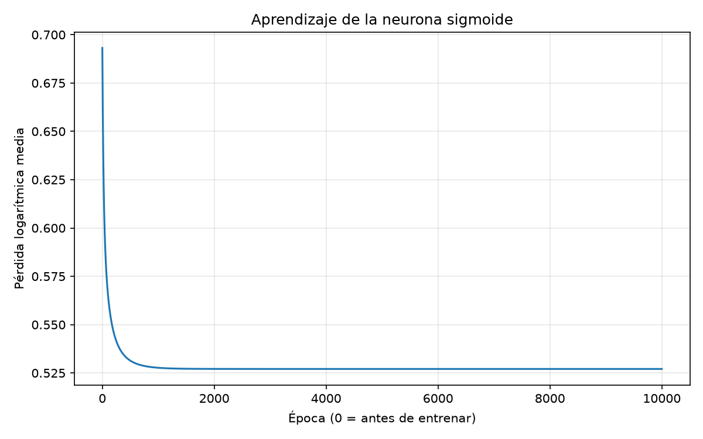

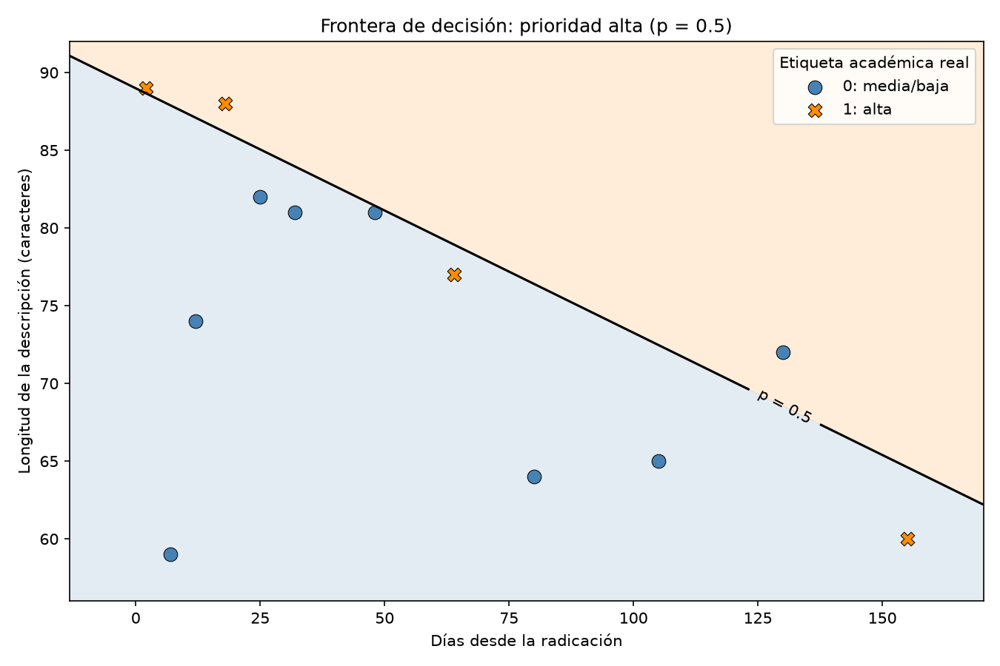

Los pesos positivos aumentan la probabilidad estimada al aumentar cada entrada,
manteniendo fija la otra; no implican causalidad. Las etiquetas no son
linealmente separables con estas dos entradas. El análisis, la justificación
geométrica y las limitaciones están en
[`perceptron/interpretacion.md`](informes/segundo_corte/perceptron/interpretacion.md).
El 75 % es exactitud de entrenamiento, no una evaluación de generalización.

### Verificación y trazabilidad del avance

Las 19 pruebas de `tests/` ya fueron ejecutadas con éxito en Docker, Python
3.13.16: 8 de preparación, 4 de visualizaciones y 7 del modelo. Cubren calidad
de datos, preservación de archivos, gráficos, gradiente analítico frente a
diferencias finitas, estabilidad numérica y reproducibilidad. Dos ejecuciones
del modelo produjeron la misma salida y los mismos SHA-256 de ambos gráficos.

Se versionan el código, cuatro CSV nuevos (etiquetas, limpio, entradas/objetivo
y resumen de limpieza), cinco gráficos del segundo corte, dos interpretaciones
y tres archivos de pruebas. Los datasets y gráficos anteriores no se eliminan.
El trabajo se organiza en commits de preparación, visualizaciones, modelo,
pruebas y documentación, sin reescribir el historial previo.

La publicación de estos commits en GitHub queda pendiente de autorización.
No se generan PDF ni video ni se incorporan funcionalidades adicionales.


## Clase 12 - Scikit-Learn y modelo final de PQRS

### Objetivo

Entrenar y comparar modelos de clasificación para estimar si una PQRS
tiene prioridad alta, utilizando el dataset final `data/pqrs_final_150.csv`.

### Datos utilizados

Archivo: `data/pqrs_final_150.csv` (150 registros sintéticos, semilla 42).
La descripción completa de las variables, la fuente, la privacidad y las
limitaciones está en la sección [Datos](#datos) y en
[`data/README.md`](data/README.md).

- Entradas (contrato único): `dias_desde_radicacion`, `longitud_descripcion`,
  `cantidad_adjuntos` y `tipo`.
- Objetivo: `prioridad_alta` (0 = no alta, 1 = alta), con distribución 120/30.

### Modelos evaluados

Se utilizaron tres clasificadores de Scikit-Learn:

1. Regresión logística.
2. K vecinos más cercanos (KNN).
3. Árbol de decisión.

Cada modelo se define dentro de un `Pipeline` reproducible que integra el
preprocesamiento y el clasificador:

- Las variables numéricas (`dias_desde_radicacion`, `longitud_descripcion`,
  `cantidad_adjuntos`) se estandarizan con `StandardScaler`.
- La variable categórica `tipo` se codifica con `OneHotEncoder`, tolerante a
  categorías no vistas durante el entrenamiento.

Los datos se dividieron en 80 % para entrenamiento y 20 % para prueba
(120 y 30 casos respectivamente), con `random_state=42` y estratificación.
La selección del mejor modelo se realiza con validación cruzada de
5 pliegues sobre los datos de entrenamiento.

### Resultados

Modelos evaluados sobre 30 casos de prueba:

| Modelo | Exactitud | Precisión | Recall | F1 | F1 validación cruzada |
|---|---:|---:|---:|---:|---:|
| Regresión logística | 0.767 | 0.400 | 0.333 | 0.364 | 0.433 |
| KNN | 0.733 | 0.375 | 0.500 | 0.429 | 0.205 |
| Árbol de decisión | 0.733 | 0.400 | 0.667 | 0.500 | 0.281 |

### Criterio de selección

El modelo seleccionado es la **regresión logística** porque el criterio de
selección fue definido previamente como el **mayor F1 promedio de validación
cruzada** (0.433). El árbol de decisión obtuvo el mejor F1 en el conjunto de
prueba (0.500), pero no fue seleccionado para evitar elegir el modelo después
de observar el test: escoger por resultados de prueba convertiría el conjunto
de prueba en parte del entrenamiento y sesgaría la evaluación.

Matriz de confusión de la regresión logística (filas reales, columnas
predichas, orden [0, 1]):

| Real / Predicho | No alta | Alta |
|---|---:|---:|
| No alta | 21 | 3 |
| Alta | 4 | 2 |

De los 6 casos reales de prioridad alta del conjunto de prueba, el modelo
identificó correctamente 2 (recall de 0.333). La exactitud global (0.767)
debe interpretarse con cautela por el desbalance de clases (120/30).

### Gráficos de evaluación

Los tres gráficos siguientes se regeneran desde el código con los comandos de
la sección de ejecución.

#### Curva de aprendizaje del perceptrón

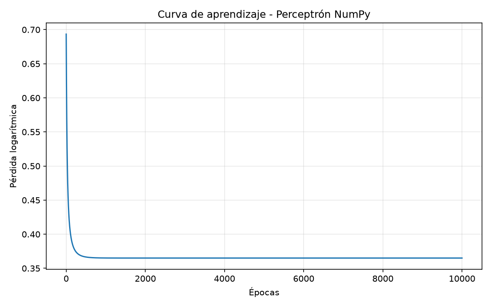

- Ruta: `graficos_final/curva_perceptron.png`
- Pérdida logarítmica por época durante el entrenamiento del perceptrón
  implementado con NumPy (`src/perceptron_final.py`). La pérdida desciende de
  forma sostenida y se estabiliza, lo que muestra la convergencia del descenso
  del gradiente; no es una medida de generalización.

#### Matriz de confusión

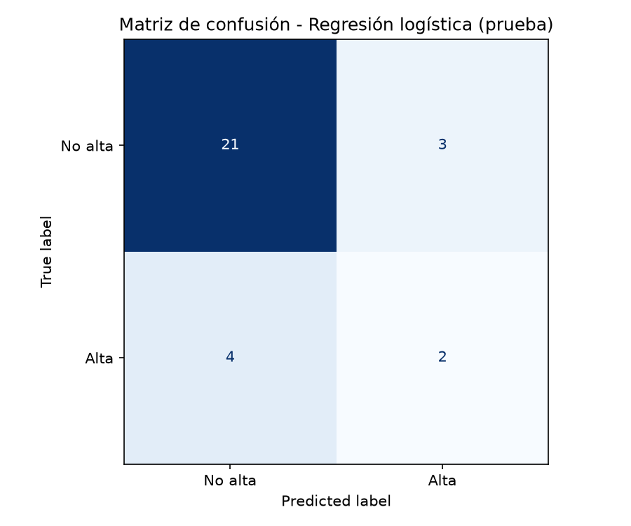

- Ruta: `graficos_final/matriz_confusion.png`
- Comparación entre la clase real y la predicha por la regresión logística en
  los 30 casos de prueba (21 verdaderos negativos, 3 falsos positivos,
  4 falsos negativos y 2 verdaderos positivos). Muestra que el modelo reconoce
  bien la clase mayoritaria "no alta", pero detecta solo 2 de los 6 casos de
  prioridad alta.

#### Real vs predicho

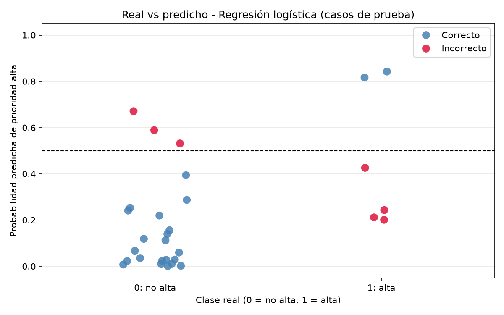

- Ruta: `graficos_final/real_vs_predicho.png`
- Cada punto es un caso de prueba: el eje X indica la clase real y el eje Y la
  probabilidad predicha de prioridad alta. La línea discontinua es el umbral
  de decisión (p = 0.5); los puntos azules son aciertos y los rojos errores.
  Los errores se concentran cerca del umbral (3 falsos positivos sobre 0.5 en
  la clase 0 y 4 falsos negativos bajo 0.5 en la clase 1); recuerda que las
  probabilidades no están calibradas.

### Comparación con el perceptrón del Avance 2

El perceptrón implementado con NumPy (Avance 2) obtuvo una exactitud de
entrenamiento del 75 % (9 de 12 registros sintéticos).

La regresión logística del modelo final obtuvo una exactitud de prueba del
0.767 (sobre 30 casos independientes del entrenamiento) en el dataset de
150 registros.

Estas métricas no son directamente comparables porque el perceptrón
fue evaluado sobre los datos utilizados para entrenarlo y sobre otro
conjunto de datos (12 casos), mientras que Scikit-Learn utilizó un
conjunto independiente de prueba (30 casos del dataset de 150).

### Ejecución

Desde la raíz de **CursoIA**, con Docker iniciado, esta es la cadena única y
reproducible del modelo final (generación de datos, entrenamiento, gráficos y
predicción):

```bash
docker compose build
docker compose run --rm -e MPLBACKEND=Agg python python proyectos/resuelve-pqrs/src/generar_datos.py
docker compose run --rm -e MPLBACKEND=Agg python python proyectos/resuelve-pqrs/src/perceptron_final.py
docker compose run --rm -e MPLBACKEND=Agg python python proyectos/resuelve-pqrs/src/modelo_proyecto.py
docker compose run --rm -e MPLBACKEND=Agg python python proyectos/resuelve-pqrs/src/usar_modelo.py
```

1. `generar_datos.py` crea `data/pqrs_final_150.csv` de forma determinista
   (semilla 42); regenerarlo produce siempre el mismo archivo.
2. `perceptron_final.py` entrena el perceptrón con NumPy y genera
   `graficos_final/curva_perceptron.png`.
3. `modelo_proyecto.py` entrena y compara los tres modelos, guarda el mejor
   en `modelo_pqrs_final.joblib` y genera la matriz de confusión y el gráfico
   de clase real frente a probabilidad predicha en `graficos_final/`.
4. `usar_modelo.py` carga el modelo guardado y realiza predicciones sobre
   tres casos nuevos **sin volver a entrenarlo**.

#### Salida esperada de `usar_modelo.py`

| dias_desde_radicacion | longitud_descripcion | cantidad_adjuntos | tipo | probabilidad_prioridad_alta_% | prioridad_predicha |
|---:|---:|---:|---|---:|---|
| 5 | 90 | 1 | Petición | 0.1 | No alta |
| 45 | 65 | 3 | Queja | 1.1 | No alta |
| 120 | 75 | 5 | Reclamo | 57.9 | Alta |

Es decir: 5 días, longitud 90, 1 adjunto, Petición: 0.1 %, No alta;
45 días, longitud 65, 3 adjuntos, Queja: 1.1 %, No alta;
120 días, longitud 75, 5 adjuntos, Reclamo: 57.9 %, Alta.

### Limitaciones

- Los 150 registros son **sintéticos** y no provienen de PQRS reales.
- **Circularidad metodológica:** `prioridad_alta` se generó a partir de las
  mismas variables predictoras del modelo, por lo que existe una fuga de
  información estructural entre las entradas y la etiqueta; las métricas
  reflejan la recuperación de una regla artificial, no validez predictiva real.
- El conjunto es limitado (150 registros) y está **desbalanceado (120/30)**.
- El **recall de la clase prioridad alta es bajo (0.333)**: de 6 casos de
  prueba de prioridad alta solo se detectaron 2.
- Las probabilidades generadas por el modelo **no están calibradas**.

El modelo constituye una demostración académica y no debe
utilizarse para asignar prioridades reales de PQRS sin disponer
de datos suficientes, etiquetas verificadas y evaluación adicional.

## Informe final

El informe final se entrega en formato PDF a través de AVACO, según los
lineamientos del curso.
