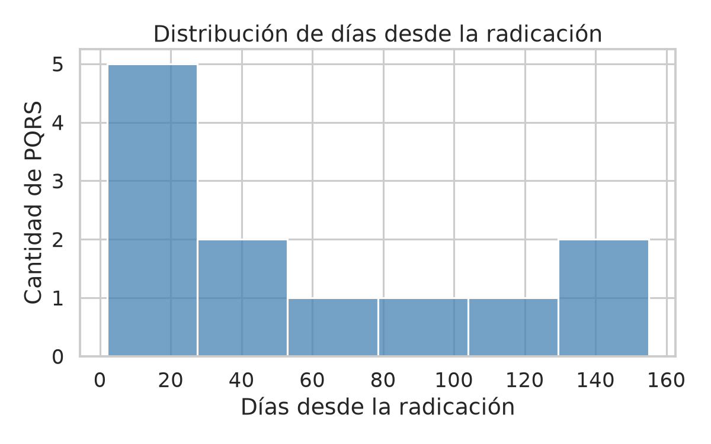
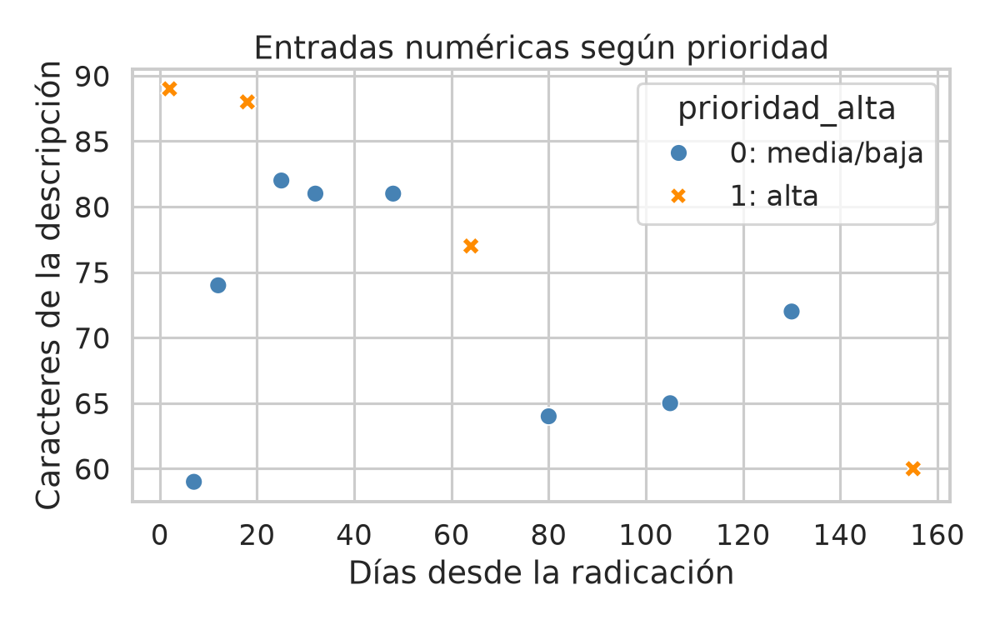

# Segundo corte - Requisito C: visualizaciones

Fuente: `data/pqrs_limpias_segundo_corte.csv` (12 casos sintéticos).
Se reutilizan los gráficos de Seaborn de Clase 7, sin sobrescribirlos.

## 1. Distribución de días desde la radicación

La antigüedad va de 2 a 155 días, con mediana de 40 días.
La dispersión de esta entrada respalda revisar su escala y considerar una normalización futura; el histograma no determina la prioridad.

## 2. Cantidad de PQRS por tipo

El tipo más frecuente es Reclamo, con 4 de 12 casos (33.3%); las categorías tienen una representación desigual.
Esto respalda explicitar la cobertura limitada de escenarios; el tipo se conserva como contexto y no se añade a las dos entradas numéricas elegidas.

## 3. Entradas numéricas y prioridad alta

Cada punto relaciona días y caracteres con su etiqueta (0: 8 casos; 1: 4), distinguida por color y marcador.
Respalda examinar conjuntamente ambas entradas frente a las anotaciones semánticas; la inspección visual no demuestra separabilidad lineal ni capacidad predictiva.

Las etiquetas son académicas y subjetivas; 12 registros no permiten generalizar resultados.
